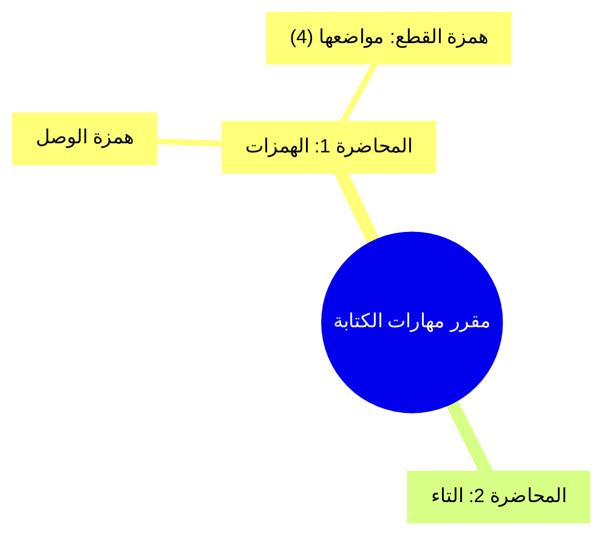

# بنية المخرجات (Output Structure)

## الملف الأول: `محاضرات_<اسم_المقرر>_كاملة.md`
صمّمه ليسترجع منه أي نموذج لغوي محاضرة بعينها فورًا.

1. **ترويسة إرشادية للنموذج (LLM Navigation Guide):** صندوق اقتباس في أول الملف يذكر عدد المحاضرات، وأن التفريغ حرفي، وكيف تُستعمل الوسوم للوصول إلى أي محاضرة.
2. **جدول الفهرس:** يربط بين رقم المحاضرة أو القسم، وعنوانها، وعدد الشرائح أو نطاق الصفحات، والوسم المرجعي.

   | # | عنوان المحاضرة | الشرائح/الصفحات | الوسم |
   |---|---|---|---|
   | 0 | توصيف المقرر | 1-4 | `COURSE_INTRO` |
   | 1 | ... | 5-22 | `LECTURE_1` |

3. **وسوم الفصل:** أحط كل محاضرة بوسم بداية ووسم نهاية صريحين، كلٌّ منهما تعليق HTML في سطر مستقل يحوي اسم الوسم وحده، حتى لا يظهر في العرض ويبقى قابلًا للبحث:
   - `START_COURSE_INTRO` ... `END_COURSE_INTRO` لمدخل المقرر إن وُجد.
   - `START_LECTURE_1` ... `END_LECTURE_1` للمحاضرة الأولى، وهكذا لبقية المحاضرات.
   - إن طلب المستخدم وسومًا ظاهرة، فاكتبها بين معقوفين بالأسماء نفسها: `[START_LECTURE_1]` و`[END_LECTURE_1]`.
4. **علامة كل شريحة:** في بداية كل شريحة علامة مرجعية مثل `**[المحاضرة X - شريحة Y / صفحة Z]**` ليسهل الاستشهاد برقم الشريحة أو الصفحة.
5. **العناوين:** `#` لعنوان المحاضرة الرئيسي، و`##` و`###` للعناوين الفرعية داخلها. تجنّب الفاصل الأفقي `---` بين الفقرات، فبعض المحللات النصية تقسم الملف عنده.

## الملف الثاني: `الخريطة_الذهنية_لمحاضرات_<اسم_المقرر>.md`
1. **مخطط Mermaid ذهني:** كتلة كود `mermaid` تبدأ بـ `mindmap` ثم جذر المقرر `root`، تتفرع إلى كل المحاضرات، ومن كل محاضرة إلى محاورها وتعريفاتها وشروطها وقواعدها وأمثلتها الرئيسية.
2. **هيكل شجري تفصيلي:** قائمة نقطية متدرجة أسفل المخطط تعرض المحاضرات وموضوعاتها الفرعية ونطاق شرائحها، مرجعًا سريعًا للمراجعة ولمن لا يعرض بيئته Mermaid.

مثال مختصر:

## قواعد Mermaid وأخطاؤها
- ضع كل نص فيه نقطتان أو أقواس أو رموز خاصة داخل علامات تنصيص: `["النص: تفاصيل (1)"]`. الأقواس غير المهرّبة تكسر `mindmap`.
- المسافات البادئة تحدد التفرع: حافظ على إزاحة ثابتة (مسافتان لكل مستوى) ولا تخلط المسافات بمحارف الجدولة.
- لا تضع أكثر من عقدة في السطر الواحد.
- إن طال المخطط جدًا فاقتصر في المخطط على مستويين أو ثلاثة، واترك التفاصيل كاملة للهيكل الشجري.
